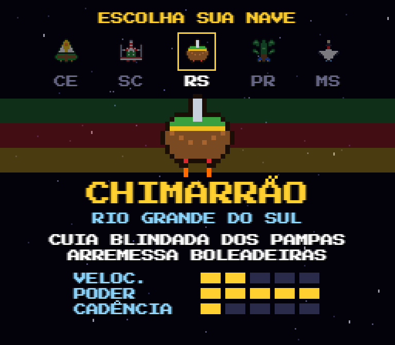
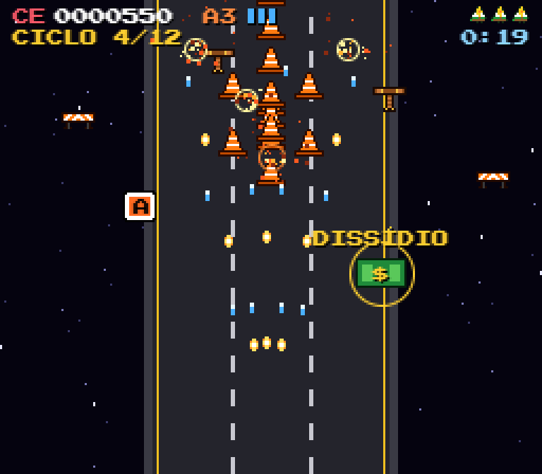
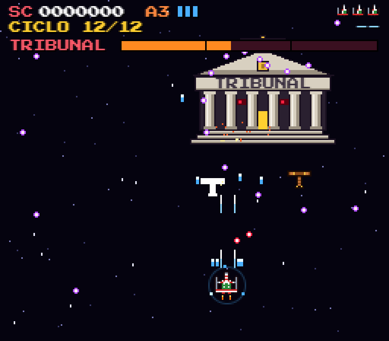

# Nave STG — Contra o Tribunal

Shoot 'em up vertical no estilo 16-bit, inspirado nos jogos de nave do Super Nintendo, que roda direto no navegador, no computador e no celular.

**▶ Jogue agora: https://thiagobsn.github.io/nave-stg/**

<p align="center">
  
  
  
</p>

## A história

Cinco estados mandam suas naves contra o **Tribunal**, um prédio de colunas armado até o frontão. São **12 ciclos de dúvidas** cheios de servos do Tribunal e de obras na rodovia. No ciclo 6 aparece uma prévia do chefe, que se divide em três ao ser vencida, e no ciclo 12 acontece o julgamento final.

## As naves

| Estado | Nave | Tiro |
|---|---|---|
| Ceará | **Jangada**: vela ao sol do nordeste | raios de sol em leque |
| Santa Catarina | **Hercílio**: a ponte que virou nave | laser rápido de "cabos de aço" |
| Rio Grande do Sul | **Chimarrão**: cuia blindada dos pampas | boleadeiras giratórias que atravessam inimigos |
| Paraná | **Araucária**: a gigante dos pinhais | metralhadora de pinhões |
| Mato Grosso do Sul | **Tuiuiú**: símbolo do Pantanal | agulha veloz que atravessa inimigos |

Cada nave tem velocidade, poder e cadência diferentes.

## Como jogar

| Ação | Teclado | Celular |
|---|---|---|
| Mover | setas ou WASD | manete à esquerda |
| Atirar | Espaço, Z ou J | botão **A** |
| Modo lento (mostra o ponto de colisão) | Shift ou X | botão **B** |
| Pausar | P ou Enter | **START** |
| Ligar/desligar o som | M | **SOM** |

Na pausa, Esc (ou B no celular) volta para a escolha de nave.

## Ciclos, inimigos e chefes

- **Ciclos comuns (30 s cada):** ondas de inimigos que ficam mais fortes a cada ciclo. Os ciclos pares acontecem numa rodovia.
- **Servos do Tribunal:** processo, martelo de juiz, carimbo e balança da justiça.
- **Obras e rodovias:** cone, betoneira, rolo compactador e barreira zebrada.
- **Ciclo 6, a prévia do Tribunal:** ao ser derrotado ele se divide em três. Um cai, outro foge como foguete e o terceiro luta no **CICLO EXTRA**.
- **Ciclo 12, o chefe final:** três fases, "Sessão Extraordinária" e "Julgamento Final" incluídos.

## Buffs

- **Comuns, em todo ciclo:** **A** sobe o nível da arma (até 3) e **E** dá um escudo que aguenta 3 tiros.
- **Especiais**, cédulas que quicam pela tela até serem pegas:

| Ciclo | Buff | Efeito |
|---|---|---|
| 3 | **PLR** | restaura todas as vidas, arma no máximo e escudo cheio |
| 6 | **Décimo 1/2** | +1 vida e escudo |
| 8 | **Dissídio** | +25% de dano permanente |
| 12 | **Décimo 2/2** | +1 vida, arma no máximo e escudo; com as duas parcelas, bônus de 13000 pontos |

Perdeu todas as vidas? Na tela de game over dá para **fazer hora extra**: as vidas voltam e o jogo continua de onde parou. No ranking, quem fez hora extra ganha um `*`.

## Ranking

Os 10 melhores ficam salvos no navegador de cada aparelho. Para ter um ranking único para todos os jogadores, existe a opção de usar o Supabase (grátis): o passo a passo está em [RANKING.md](RANKING.md).

## Rodando no seu computador

Não precisa instalar nada além do [Node.js](https://nodejs.org/):

```bash
node server.js
```

Depois abra http://localhost:8080. Para começar direto num ciclo, use `?ciclo=N`, por exemplo http://localhost:8080/?ciclo=12.

## Como o código é organizado

JavaScript puro, sem bibliotecas nem etapa de build. Tudo é desenhado num `<canvas>` de 256×224 (a resolução do SNES), e todo o som é sintetizado com Web Audio.

| Arquivo | O que faz |
|---|---|
| `nucleo.js` | tela, teclado, texto pixelado, explosões e balas inimigas |
| `naves.js` | as cinco naves (sprites, cores e atributos) |
| `jogador.js` | movimento, tiros, escudo e dano da nave |
| `inimigos.js` | inimigos menores e suas formações |
| `tribunal.js` | o chefe: prévia, divisão em três, ciclo extra e chefe final |
| `buffs.js` | itens comuns e especiais |
| `ciclos.js` | os 12 ciclos, a rodovia e os anúncios na tela |
| `som.js` | efeitos e músicas chiptune |
| `toque.js` | controles na tela para celular |
| `ranking.js` / `config.js` | ranking local e online |
| `game.js` | estados do jogo, telas e laço principal |

Os sprites ficam no próprio código, como texto: cada linha é uma fileira de pixels e cada letra é uma cor da paleta.

## Créditos

Criado por **Thiago Bernardo**, desenvolvido com **Claude**.

## Licença

[MIT](LICENSE): você pode jogar, estudar, modificar e redistribuir, desde que mantenha o aviso de copyright.
